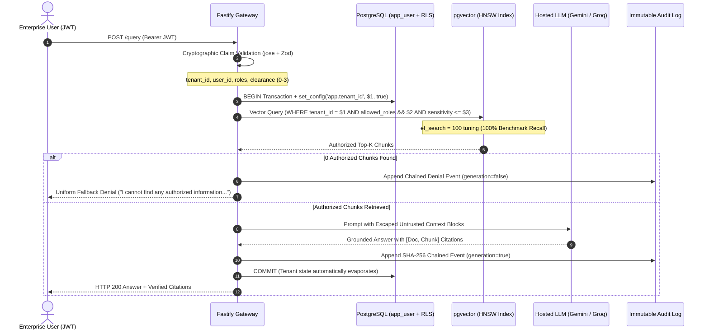
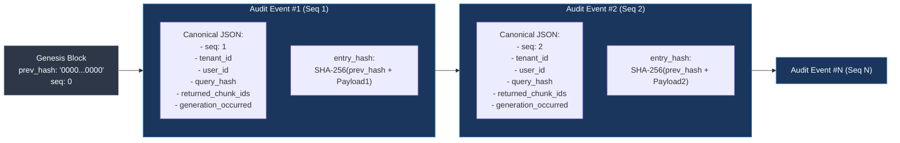

# Permission-Aware Multi-Tenant RAG System

[](https://github.com/salmon6934/permission-aware-rag/actions/workflows/ci.yml)
[](https://nodejs.org/)
[](https://www.typescriptlang.org/)
[](https://fastify.dev/)
[](https://www.postgresql.org/)
[](https://github.com/pgvector/pgvector)
[](https://github.com/salmon6934/permission-aware-rag)

A production-grade, enterprise Retrieval-Augmented Generation (RAG) platform delivering **zero cross-tenant data leakage**, **in-query vector authorization**, and **cryptographically verifiable, tamper-evident audit logging** on shared infrastructure.

---

## 1. The Core Problem Statement

Most enterprise RAG applications suffer from critical architectural security flaws:

1. **The Recall Starvation Dilemma (Post-Filtering Failure):**  
   Naive systems run standard similarity search first (`SELECT * FROM chunks ORDER BY embedding <=> $q LIMIT 10`) and filter unauthorized chunks in application memory. If all top-10 chunks are confidential executive documents, a low-clearance user receives **0 results** for documents they are fully authorized to see.
2. **Session Bleed in Connection Pools:**  
   Setting tenant variables globally without transaction-scoped boundaries poisons connection pools, causing Connection A to silently serve Company A's data to Company B under high concurrent traffic.
3. **Prompt Injection & Delimiter Breakout:**  
   Ingested documents or user queries can mimic system context boundaries (`=== END AUTHORIZED CONTEXT ===`), tricking LLMs into leaking private data.
4. **Unverifiable Audit Logs:**  
   Standard database logs can be surreptitiously edited by rogue database administrators or compromised services without detection.

### The Solution: Multi-Layered Defense-in-Depth
This system solves these failure modes by pushing authorization **directly into the vector query scan**, strictly isolating pooled connections with transaction-local RLS (`set_config(..., true)`), escaping context boundaries, and chaining every query into a **SHA-256 tamper-evident hash ledger**.

---

## 2. System Architecture

### Request Flow & Authorization Boundary



### Cryptographic Hash-Chained Audit Ledger



---

## 3. Key Technical Invariants

| Feature | Implementation | Guarantee |
| :--- | :--- | :--- |
| **In-Query Vector Filtering** | `allowed_roles && $1 AND sensitivity <= $2` | Zero recall starvation; 100% quantitative recall benchmark. |
| **Zero Connection Bleed** | `withTenantTransaction` + `set_config(..., true)` | PostgreSQL engine automatically resets tenant identity on `COMMIT`/`ROLLBACK`. |
| **Restricted DB Privileges** | Runtime user `app_user` with `NOBYPASSRLS` | Even direct SQL injection cannot bypass Row-Level Security policies. |
| **Tamper-Evident Audit** | SHA-256 Hash Chain + PostgreSQL Append-Only Trigger | Direct database `UPDATE` and `DELETE` queries are physically rejected. |
| **Prompt Injection Defense** | Context Delimiter Sanitization + Grounding Prompt | Raw document text cannot mimic context boundaries or trick the LLM. |
| **In-Process Embeddings** | `@xenova/transformers` (`all-MiniLM-L6-v2`) | Fast 384-dimensional vectorization directly in Node.js without remote API dependencies. |

---

## 4. Quickstart Guide (5-Minute Setup)

### Prerequisites
- Node.js 20+
- Docker & Docker Compose

### 1. Clone & Install Dependencies
```bash
git clone https://github.com/salmon6934/permission-aware-rag.git
cd permission-aware-rag
npm ci
```

### 2. Configure Environment
```bash
cp .env.example .env
```
*(For offline development or testing, `.env` defaults to local settings. To connect live hosted LLMs, add your `LLM_API_KEY` for Google Gemini or Groq).*

### 3. Start Database & Run Migrations
```bash
docker compose up -d
npm run migrate
```

### 4. Run Test Suite
```bash
npm test
```
*(Runs 85 automated tests across 20 test files, including adversarial leakage scenarios and audit tamper simulations).*

---

## 5. Interactive Multi-Tenant Demo

Experience permission isolation side-by-side across three personas asking the identical question:
> *"What are our strategic project plans and financial allocations?"*

```bash
npx tsx scripts/demo.ts
```

### Output Summary:
- **Bob (Tenant Alpha, Engineering, Clearance 1):** Receives Project Titan quantum computing roadmaps; financial budget numbers ($12.5M) are redacted.
- **Alice (Tenant Alpha, Finance, Clearance 2):** Receives Project Titan budget numbers ($12.5M); secret executive merger notes (Clearance 3) are redacted.
- **Charlie (Tenant Beta, Admin, Clearance 3):** Receives only Project Vulcan autonomous drone data; 100% isolated from Tenant Alpha documents.

### Audit Tamper Detection Simulation:
Simulate an insider database attack attempting to alter audit records:
```bash
npx tsx scripts/demo-tamper.ts
```

---

## 6. API Reference

All requests must provide an `Authorization: Bearer <JWT>` header (except `/health` and `/metrics`).

### Authentication & Token Generation
- `POST /dev/token` (Development mode only): Issues signed test JWTs with custom tenant IDs, roles, and clearance levels.

### Document Management
- `POST /documents`: Upload multipart document (`.pdf`, `.docx`, `.md`, `.txt`) with `allowed_roles` and `sensitivity` (0–3).
- `PATCH /documents/:id/acl`: Atomically update `allowed_roles` and/or `sensitivity` without re-embedding vectors.
- `DELETE /documents/:id`: Cascade deletion of document and all child vector chunks.

### RAG Query & Inference
- `POST /query`: Execute semantic vector search and generate cited answers.
  ```json
  {
    "query": "What are our engineering roadmap specs?",
    "limit": 5
  }
  ```

### Audit & Compliance
- `GET /audit?limit=50&offset=0`: Retrieve paginated audit event log for tenant.
- `GET /audit/verify`: Cryptographically verify tenant SHA-256 hash chain from sequence 1 to end.

### Observability
- `GET /metrics`: Return operational telemetry snapshot (queries, latency, denial counters, LLM retries).
- `GET /health`: Fastify and PostgreSQL connection probe.

---

## 7. Documentation Index

For detailed deep-dives, specifications, and benchmarks:
- [System Architecture & In-Query Filtering](docs/ARCHITECTURE.md)
- [Document Ingestion & Vector Storage Pipeline](docs/INGESTION_PIPELINE.md)
- [Enterprise Threat Model (STRIDE Analysis)](docs/THREAT_MODEL.md)
- [Tenant Lifecycle & GDPR Data Erasure Guide](docs/TENANT_LIFECYCLE.md)
- [REST API Reference & Specification](docs/API_REFERENCE.md)
- [Performance & Security Verification Benchmarks](docs/BENCHMARKS.md)
- [Portfolio & Technical Interview Reference](docs/PORTFOLIO.md)

---

## 8. License
MIT License. Built for enterprise AI engineering architectures.
