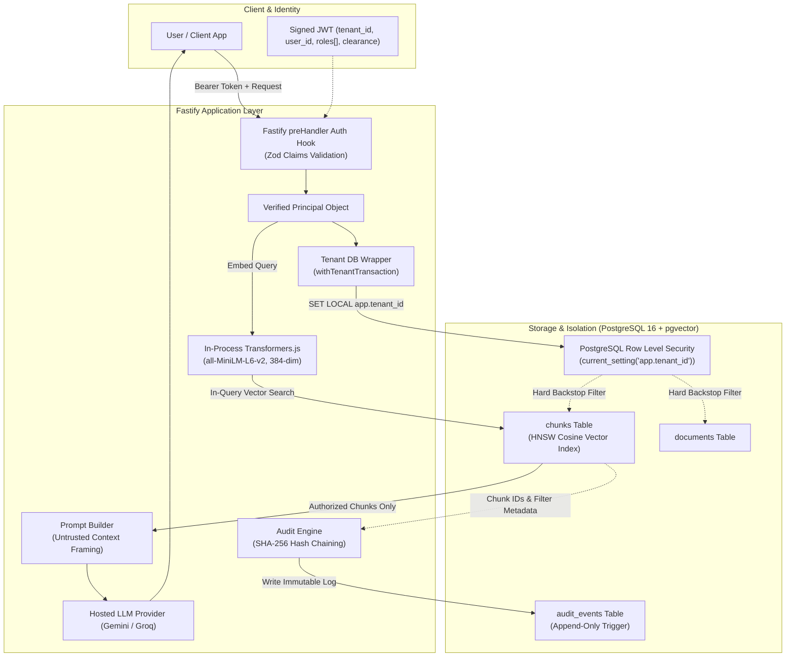
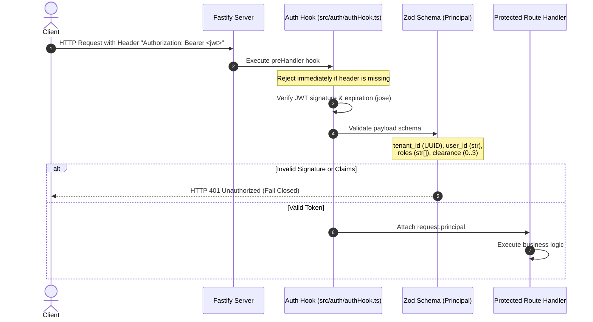
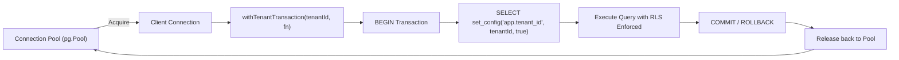
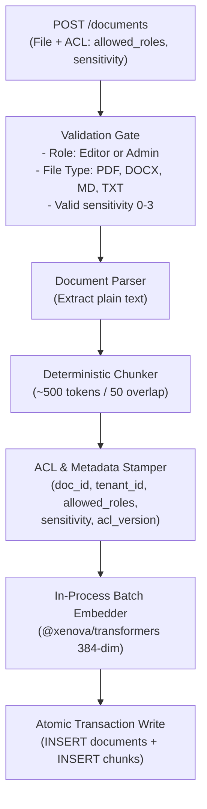
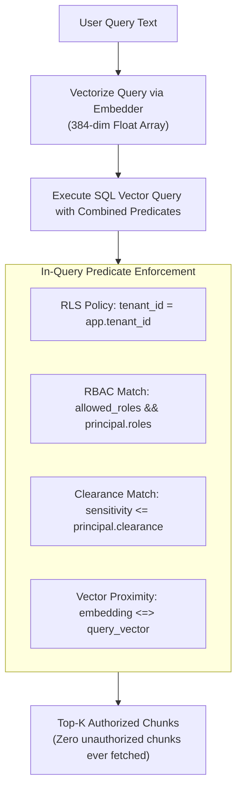
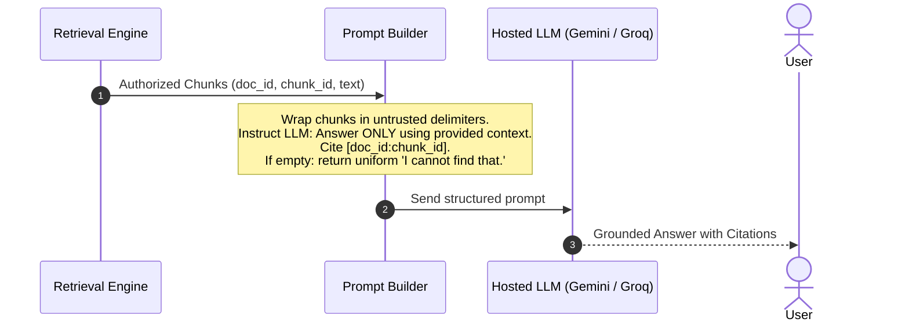
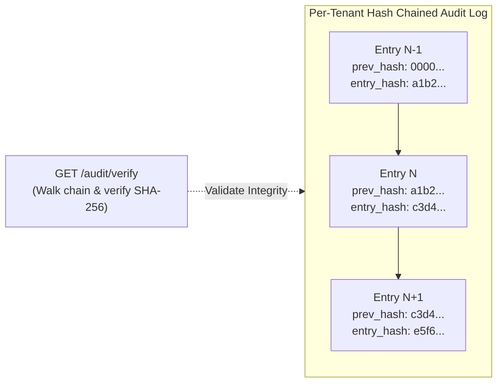
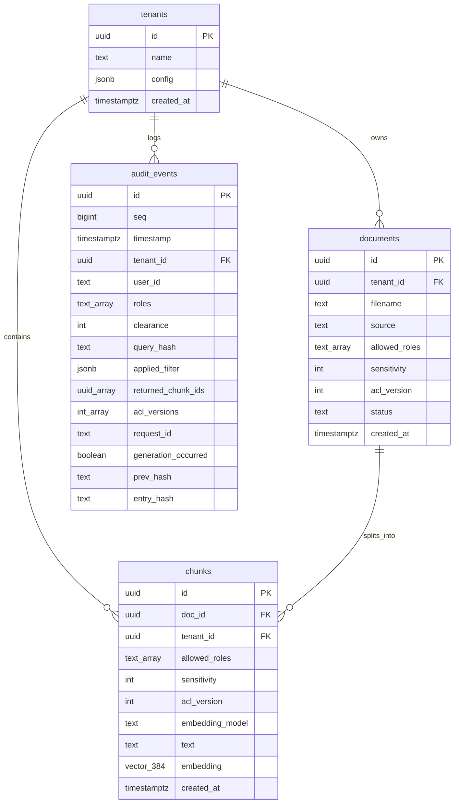

# Permission-Aware Multi-Tenant RAG: System Architecture

## 1. Executive Summary & Purpose

In standard Retrieval-Augmented Generation (RAG) architectures, access control is frequently treated as an afterthought—either applied as post-retrieval filtering in application code or delegated to prompt instructions for the Large Language Model (LLM). This design creates critical vulnerabilities:
- **Context Pollution & Information Leakage:** Unauthorized chunks can enter LLM context or memory.
- **Prompt Injection Vulnerability:** Documents containing adversarial instructions can command the model to disregard access rules.
- **Recall Degradation:** Post-filtering top-$K$ vector matches often discards valid documents, returning empty or degraded answers.
- **Lack of Non-Repudiation:** Missing or mutable logs leave zero cryptographic proof of who accessed what data.

This project implements a **zero-leakage, production-grade multi-tenant RAG architecture** where authorization is enforced **directly within the vector retrieval SQL query** and backstopped by **PostgreSQL Row-Level Security (RLS)**.



---

## 2. Core Architectural Principles

1. **Authorize Before Retrieval (In-Query Filtering):**  
   Security filters (`tenant_id`, `allowed_roles`, `sensitivity <= clearance`) are embedded directly into the vector distance SQL search (`WHERE` clause alongside vector operators), never filtered in application memory after retrieval.
2. **Stamp at Write Time:**  
   Every ingested document chunk is immutable and stamped with its Access Control List (`allowed_roles`, `sensitivity`, `tenant_id`, `acl_version`). A chunk cannot exist without valid access metadata.
3. **Hard Multi-Tenant Isolation via RLS:**  
   PostgreSQL Row-Level Security (RLS) is forced across all tenant tables. Even if an application query has a flawed `WHERE` clause, the database kernel strictly hides data belonging to other tenants.
4. **Least-Privilege Database Role:**  
   The runtime application connects as `app_user` (strictly `NOSUPERUSER NOBYPASSRLS`). Schema updates and migrations are run by a dedicated `migrator` role. A process startup assertion crashes the server immediately if `app_user` ever has `BYPASSRLS`.
5. **Fail-Closed Security Design:**  
   Any missing claim, expired token, unknown role, unparseable input, or database connection error fails closed, returning HTTP 401/403 or zero results—never unfiltered data.
6. **Zero Existence Leaks:**  
   A user requesting a document or topic they do not have clearance to read receives the exact same response as if the document did not exist. Error messages and responses never confirm whether restricted data exists.
7. **Tamper-Evident Cryptographic Auditing:**  
   Every query logs an append-only audit record linked to the previous entry via SHA-256 hash chaining (`entry_hash = SHA-256(prev_hash || canonical_json(entry))`). Database triggers prohibit any `UPDATE` or `DELETE`.

---

## 3. Subsystem Breakdown

### 3.1 Identity & Authentication Layer (Day 2)



- **Claims Structure:**
  - `tenant_id` (`string / UUID`): The tenant partition identifier.
  - `user_id` (`string`): The user identifier.
  - `roles` (`string[]`): Security roles assigned to the user (e.g., `["engineer", "member"]`).
  - `clearance` (`integer 0–3`): Hierarchical clearance level:
    - `0 = public`
    - `1 = internal`
    - `2 = confidential`
    - `3 = restricted`
- **Tamper Protection:** The client cannot supply a `tenant_id` or permission overrides in the request body or query string. Filter metadata is sourced **exclusively** from the cryptographically verified JWT.

---

### 3.2 Hardened Database & Tenant-Scoped Connection Wrapper (Days 1 & 2)



- **Session Variable Scoping:** Connection pools (`node-postgres`) reuse physical sockets. Setting session variables via `SET app.tenant_id = ...` risks leaking tenant state to subsequent requests.
- **The Solution:** The `withTenantTransaction` wrapper executes:
  ```sql
  BEGIN;
  SELECT set_config('app.tenant_id', $1, true); -- true = local to current transaction
  -- Application queries executed here
  COMMIT;
  ```
- **Guaranteed Isolation:** When the transaction completes or rolls back, `app.tenant_id` reverts to empty. When checked out again, raw queries without an active tenant transaction match 0 rows.

---

### 3.3 Ingestion Pipeline (Day 3)



- **Parsers:** Extract text from Markdown (`.md`), Plain Text (`.txt`), PDF (`pdf-parse`), and DOCX (`mammoth`).
- **In-Process Embedder:** Uses `@xenova/transformers` running the quantized `all-MiniLM-L6-v2` ONNX model directly inside the Node.js process CPU (~25MB memory footprint). Eliminates network latency, Docker container overhead, or external API costs.
- **Atomicity:** The document record and all derived vector chunks are written within a single database transaction under the tenant's transaction scope.

---

### 3.4 In-Query Retrieval & Vector Search (Day 4)



#### Why In-Query Authorization is Mandatory
In naive vector search:
1. Retrieval fetches the Top-10 nearest neighbors globally across the vector space.
2. An authorization check filters out chunks the user cannot see.
3. **Failure Mode (Recall Starvation):** If 8 of the 10 closest matches belong to higher clearance or other roles, the user only receives 2 results—or none at all—even if dozens of relevant authorized documents exist.

#### The In-Query SQL Formulation
```sql
SELECT
    id,
    doc_id,
    text,
    sensitivity,
    allowed_roles,
    1 - (embedding <=> $1::vector) AS similarity
FROM chunks
WHERE
    allowed_roles && $2::text[]
    AND sensitivity <= $3::int
ORDER BY embedding <=> $1::vector
LIMIT $4;
```
Combined with the active RLS policy:
```sql
USING (tenant_id = NULLIF(current_setting('app.tenant_id', true), '')::uuid)
```
The HNSW index and database engine evaluate relevance **only** across chunks that the user is permitted to read.

---

### 3.5 Generation Layer & Prompt Injection Defense (Day 5)



- **Untrusted Context Framing:** Document contents are wrapped in explicit boundary tags (e.g. `<retrieved_context id="...">...</retrieved_context>`). The system instructions forbid the model from executing instructions found within document text.
- **Fail-Closed on Empty Retrieval:** If no authorized chunks pass similarity thresholds, the system short-circuits directly to a uniform canned response: *"I cannot find information answering your question in the available documents."* The LLM is never called with unfiltered knowledge.

---

### 3.6 Cryptographic Audit Log & Verification (Day 5)

Every query and retrieval generates an immutable entry in the `audit_events` table:



- **Hash Formula:**
  $$\text{entry\_hash} = \text{SHA-256}(\text{prev\_hash} \parallel \text{canonical\_json}(\text{payload}))$$
- **Logged Attributes:** `seq`, `timestamp`, `tenant_id`, `user_id`, `roles`, `clearance`, `query_hash` (or raw text if tenant config allows), `applied_filter`, `returned_chunk_ids`, `acl_versions`, `request_id`, `generation_occurred`.
- **Database-Level Immutability:**
  1. Revoked `UPDATE` and `DELETE` privileges for `app_user`.
  2. PostgreSQL trigger `prevent_audit_events_mutation()` that raises an exception on any row modification.
- **Tamper Detection:** If an administrator or intruder alters an audit row in the database, the hash sequence breaks. The verifier (`GET /audit/verify`) detects and flags the exact sequence number that was modified.

---

## 4. Relational Schema Architecture



### Key Database Indexes
- **`chunks.embedding`**: HNSW index with `vector_cosine_ops` (`m = 16`, `ef_construction = 64`) for high-accuracy approximate nearest neighbors.
- **`chunks.allowed_roles`**: GIN index (`gin(allowed_roles)`) for rapid array overlap evaluation (`&&`).
- **`chunks(tenant_id, sensitivity)`**: Composite B-Tree index for tenant partitioning and clearance range filters (`<=`).
- **`audit_events(tenant_id, seq)`**: Unique composite index enforcing strictly ordered sequence per tenant.

---

## 5. Security & Threat Mitigation Matrix

| Potential Attack / Threat | Severity | Mitigation Strategy | Architectural Layer |
|---|---|---|---|
| **Cross-Tenant Vector Bleed** | Critical | PostgreSQL Row-Level Security (`FORCE ROW LEVEL SECURITY`) keyed to `current_setting('app.tenant_id')`. | Database Kernel (RLS) |
| **Connection Pool Tenant Bleed** | High | `withTenantTransaction` wraps all queries in `BEGIN ... COMMIT` with `set_config('app.tenant_id', $1, true)`. | App DB Wrapper (`src/db/tenantDb.ts`) |
| **Client Role Spoofing** | High | Roles and clearance extracted strictly from verified JWT claims; request body filter fields ignored. | Fastify Auth Hook (`src/auth/authHook.ts`) |
| **BYPASSRLS Superuser Leak** | Critical | Runtime connects as unprivileged `app_user`. Startup verification terminates server if `BYPASSRLS` is detected. | Startup Hook (`src/db/pool.ts`) |
| **Recall Loss in Filtered ANN** | Medium | In-query SQL predicates combined with HNSW cosine distance; tuned `ef_search`. | Retrieval Engine (`src/services/retrieval`) |
| **Prompt Injection in Documents** | High | Document text wrapped in untrusted data delimiters. Strict prompt formatting prohibiting execution of document instructions. | Prompt Builder (`src/services/generation`) |
| **Audit Log Tampering / Deletion** | High | Database triggers blocking mutations + SHA-256 cryptographic hash chaining verified on demand. | Audit Service (`src/services/audit`) |
| **Existence Enumeration Attack** | Medium | Uniform responses and error handling for denied vs non-existent documents. | Route Handlers |

---

## 6. End-to-End Request Lifecycles

### Ingestion Flow (`POST /documents`)
1. Client sends multipart form upload with document file, `allowed_roles`, and `sensitivity`.
2. Auth hook validates JWT and asserts `editor` or `admin` role.
3. Document type is checked against allowed list (`.pdf`, `.docx`, `.md`, `.txt`).
4. Plaintext content is parsed and segmented into overlapping text chunks.
5. In-process `TransformersEmbedder` produces 384-dimensional vector embeddings for all chunks.
6. `withTenantTransaction` opens a transaction, sets tenant ID, inserts the document record, inserts all vector chunks, and commits.
7. Audit log records document ingestion event.

### Query Flow (`POST /query`)
1. Client sends `{ "query": "..." }` with Bearer token.
2. Auth hook extracts and validates `Principal` (`tenant_id`, `user_id`, `roles`, `clearance`).
3. Query text is converted to a 384-dimensional vector via `TransformersEmbedder`.
4. `withTenantTransaction` opens a tenant transaction.
5. In-query retrieval executes vector distance search with `allowed_roles && roles` and `sensitivity <= clearance`.
6. If 0 chunks match, returns uniform "Not found" response and writes audit record.
7. If chunks match, prompt builder formats citations and untrusted delimiters.
8. LLM generates grounded answer with `[doc_id:chunk_id]` citations.
9. Audit engine appends tamper-evident audit record with `prev_hash` and `entry_hash`.
10. Formatted answer and citations returned to client.

---

## 7. Roadmap & Day Progression

```
[Day 1] Foundation, Schema & RLS Isolation ───────► COMPLETED (All tests pass)
  │
[Day 2] Identity Layer & Tenant Connection Wrapper ─► NEXT STEP
  │
[Day 3] Ingestion Pipeline & File Parsers
  │
[Day 4] In-Query Filtered Retrieval & Recalls
  │
[Day 5] Generation Layer, Citations & Audit Log
  │
[Day 6] Adversarial Leakage Test Suite & CI
  │
[Day 7] Demo Scripts, Seed Scaling & Threat Model
  │
[Day 8] Production Packaging, Observability & Docs
```
