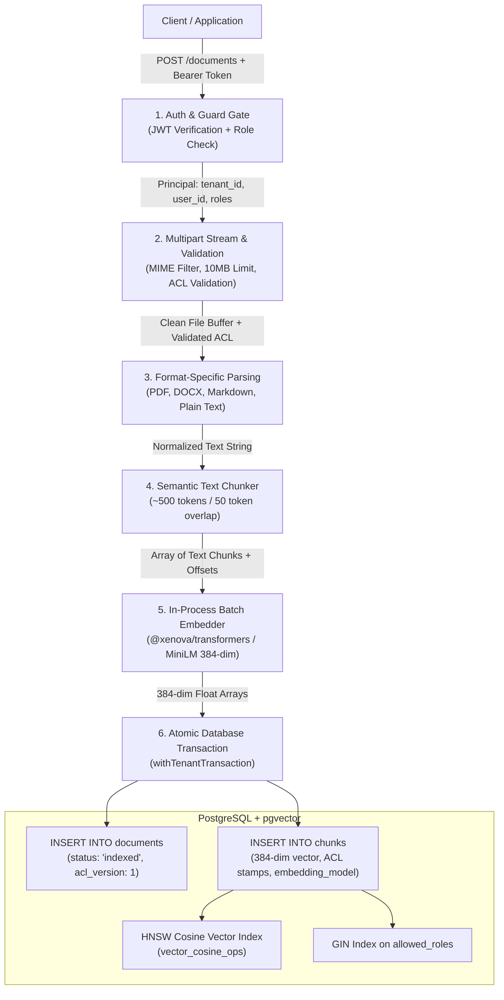

# Document Ingestion & Vector Storage Pipeline

This document details the end-to-end architecture, lifecycle stages, security boundaries, and data transformations involved when a document is uploaded, parsed, chunked, embedded, and persisted into the PostgreSQL `pgvector` database.

---

## 1. High-Level Ingestion Flow



---

## 2. Step-by-Step Technical Breakdown

### Step 1: Authentication & Authorization Gate
- **Endpoint:** `POST /documents`
- **Authentication:** Enforced by Fastify `preHandler: [authenticate]`.
  - The incoming HTTP `Authorization: Bearer <JWT>` is verified using `jose`.
  - The JWT claims are validated against `PrincipalSchema` (UUID `tenant_id`, `user_id`, `roles`, `clearance`).
  - Attached to request context as `request.principal`.
- **Role Guard:** Enforced by `requireRole(['editor', 'admin'])`.
  - Callers with read-only roles (e.g. `viewer`, `member`) are rejected immediately with **HTTP 403 Forbidden**.
- **Tenant Context Guarantee:**
  - The target `tenant_id` is derived **strictly** from `request.principal.tenant_id`.
  - Any tenant ID supplied by the client in query parameters, headers, or form-data is completely ignored to prevent cross-tenant ingestion tampering.

---

### Step 2: Multipart Streaming & Input Validation
- **Streaming Parser:** Processed using `@fastify/multipart`.
- **File Constraints:**
  - **Maximum File Size:** 10MB (enforced via streaming chunk counters to prevent memory exhaustion).
  - **MIME Whitelist:**
    - `application/pdf` (`.pdf`)
    - `application/vnd.openxmlformats-officedocument.wordprocessingml.document` (`.docx`)
    - `text/markdown` (`.md`)
    - `text/plain` (`.txt`)
  - Any unapproved MIME type is rejected immediately with **HTTP 415 Unsupported Media Type** or **HTTP 400 Bad Request**.
- **Access Control List (ACL) Fields:**
  The multipart request includes two mandatory ACL form fields:
  1. `allowed_roles` (Array of strings, e.g. `["engineering", "admin"]`): Cannot be empty.
  2. `sensitivity` (Integer 0 to 3):
     - `0` = Public
     - `1` = Internal
     - `2` = Confidential
     - `3` = Restricted
  - If ACL fields are missing or invalid, ingestion fails closed before disk or database writes occur.

---

### Step 3: Format-Specific Text Extraction & Normalization
The raw binary stream is routed to format-specific extractors under `src/ingestion/parsers/`:

| Format | Library / Engine | Extraction Logic |
| :--- | :--- | :--- |
| **PDF** | `pdf-parse` | Extracts text streams across all page dictionaries. Discards embedded image streams. |
| **DOCX** | `mammoth` | Reads internal `word/document.xml`, extracting raw paragraph and heading text while discarding stylistic XML markup. |
| **Markdown** | Native UTF-8 Decoder | Reads raw markdown content. Preserves heading syntax (`#`, `##`) as structural hints for semantic chunking. |
| **Plain Text** | Native UTF-8 Decoder | Converts UTF-8 byte stream directly to string. |

#### Text Normalization Rules:
1. Null bytes (`\u0000`) are stripped (to prevent PostgreSQL string termination errors).
2. Carriage returns (`\r\n`) are normalized to newline characters (`\n`).
3. Excessive whitespace (more than 3 consecutive newlines or duplicate space runs) is collapsed.
4. If extracted text length is 0 (e.g., scanned PDF with images only or empty file), the request is rejected with **HTTP 400 Empty Document**.

---

### Step 4: Semantic Text Chunking
Extracted text is processed by `src/ingestion/chunker.ts` to convert monolithic text into retrieval-sized windows:

- **Target Chunk Size:** ~500 tokens (~1,800 to 2,000 characters).
- **Overlap:** ~50 tokens (~180 to 200 characters).
- **Boundary Preservation Strategy:**
  1. First splits on paragraph boundaries (`\n\n`).
  2. If a paragraph exceeds 500 tokens, it splits along sentence boundaries (`. `, `? `, `! `).
  3. Preserves overlap between adjacent chunks to guarantee context is not severed across sliding boundaries.
- **Chunk Metadata Generated:**
  - `sequence_index`: Integer ordering within the document ($0, 1, 2, \dots$).
  - `char_start`: Offset index of chunk start.
  - `char_end`: Offset index of chunk end.

---

### Step 5: Metadata & ACL Stamping
Every chunk is stamped with authorization metadata inherited from the parent document:

```typescript
interface ChunkPayload {
  id: string;              // UUID v4
  doc_id: string;          // Parent Document UUID
  tenant_id: string;       // Tenant UUID (from verified token)
  allowed_roles: string[]; // e.g. ['finance', 'admin']
  sensitivity: number;     // 0 to 3
  acl_version: number;     // Starts at 1
  embedding_model: string; // 'all-MiniLM-L6-v2'
  text: string;            // Text content
  embedding: number[];     // 384-dimensional float array
}
```

> **Why ACLs are stamped directly on every chunk:**  
> During vector search, PostgreSQL evaluates permissions **inside** the vector query index scan (`allowed_roles && $userRoles AND sensitivity <= $userClearance`). Stamping each chunk avoids expensive SQL joins with the parent `documents` table during high-frequency vector distance calculations.

---

### Step 6: In-Process Batch Embedding
The chunk texts are batched and passed to `TransformersEmbedder.embed(texts)`:

1. **Quantized ONNX Execution:**
   - Runs in-process on CPU using `@xenova/transformers`.
   - The model `Xenova/all-MiniLM-L6-v2` executes in memory (~25MB RAM).
2. **Mean Pooling & Normalization:**
   - Evaluates token embeddings through 6 transformer encoder layers.
   - Computes mean pooling across token embeddings.
   - Applies $L_2$ unit normalization:
     $$\|\vec{v}\|_2 = 1.0$$
3. **Output:** An array of 384-dimensional float arrays (`number[][]`).
4. **Resilience:**
   - Batches are processed in bounded slices (e.g., 32 chunks per batch) with event-loop yielding (`setImmediate`) to keep Fastify responsive.

---

### Step 7: Atomic Database Transaction (`withTenantTransaction`)
To ensure zero data corruption or orphaned records, persistence runs inside a single ACID transaction:

```sql
BEGIN;

-- 1. Enforce tenant isolation for the current transaction
SELECT set_config('app.tenant_id', 'a0eebc99-9c0b-4ef8-bb6d-6bb9bd380a11', true);

-- 2. Insert parent document record
INSERT INTO documents (
    id, tenant_id, filename, source, allowed_roles, sensitivity, acl_version, status, created_at
) VALUES (
    'doc-uuid', 'a0eebc99...', 'q3_earnings.pdf', 'upload',
    ARRAY['finance', 'executive'], 2, 1, 'indexing', NOW()
);

-- 3. Batch insert vector chunks
INSERT INTO chunks (
    id, doc_id, tenant_id, allowed_roles, sensitivity,
    acl_version, embedding_model, text, embedding, created_at
) VALUES 
    ('chunk-uuid-1', 'doc-uuid', 'a0eebc99...', ARRAY['finance'], 2, 1, 'all-MiniLM-L6-v2', 'Chunk 1 text...', '[0.012, -0.045, ...]', NOW()),
    ('chunk-uuid-2', 'doc-uuid', 'a0eebc99...', ARRAY['finance'], 2, 1, 'all-MiniLM-L6-v2', 'Chunk 2 text...', '[-0.032, 0.089, ...]', NOW());

-- 4. Mark document as indexed
UPDATE documents SET status = 'indexed' WHERE id = 'doc-uuid';

COMMIT;
```

#### Failure Handling & Rollback:
- If file parsing, chunking, embedding, or SQL insertion fails at any point:
  1. The transaction issues a `ROLLBACK`.
  2. No partial document or orphan chunks remain in the database.
  3. The connection is released back to the pool, and `app.tenant_id` is automatically cleared.

---

### Step 8: Database Index Maintenance (`pgvector`)
Once committed, PostgreSQL automatically indexes the new chunk vectors:

1. **HNSW Cosine Vector Index:**
   ```sql
   CREATE INDEX idx_chunks_embedding_hnsw 
   ON chunks USING hnsw (embedding vector_cosine_ops)
   WITH (m = 16, ef_construction = 64);
   ```
   - Incrementally inserts 384-dimensional vectors into the HNSW graph hierarchy.
   - Configured with `vector_cosine_ops` optimized for unit-normalized vectors.
2. **GIN Role Index:**
   ```sql
   CREATE INDEX idx_chunks_allowed_roles ON chunks USING gin (allowed_roles);
   ```
   - Accelerates array overlap checks (`allowed_roles && $user_roles`).
3. **B-Tree Tenant Index:**
   ```sql
   CREATE INDEX idx_chunks_tenant_id ON chunks(tenant_id);
   CREATE INDEX idx_chunks_tenant_sensitivity ON chunks(tenant_id, sensitivity);
   ```

---

## 3. Data Flow & Security Boundaries Summary

| Boundary | Mechanism | Verification / Guarantee |
| :--- | :--- | :--- |
| **Authentication** | JWT via `jose` | Missing / expired / tampered token returns 401. |
| **Ingestion Authorization** | `requireRole(['editor', 'admin'])` | Viewers / members cannot upload files (returns 403). |
| **Tenant Isolation** | Verified `request.principal.tenant_id` | Client body `tenant_id` is ignored; cross-tenant uploads are impossible. |
| **Data Privacy** | In-Process Embedder | Document text never leaves local process memory during embedding. |
| **Database Isolation** | Postgres RLS + `SET LOCAL app.tenant_id` | Unset `app.tenant_id` yields 0 rows; no connection pool state leaks. |
| **Atomicity** | SQL Transaction (`BEGIN` ... `COMMIT`) | Either 100% of document & chunks are saved or 0%. |
